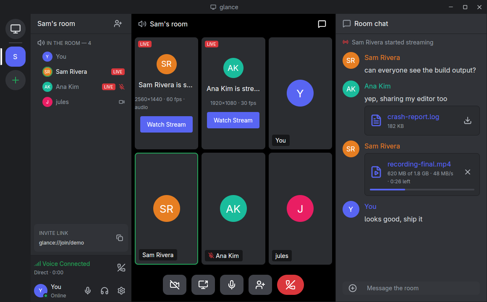

<p align="center">
  
</p>

<p align="center">
  Peer-to-peer screen sharing rooms with voice, chat and webcams, in a familiar Discord-style interface.
</p>

<p align="center">
  <a href="https://github.com/owallzz/glance/actions/workflows/ci.yml"></a>
  <a href="#license"></a>
</p>

<p align="center">
  
</p>

Start a room, send the link, and everyone in it can go live at the same time. There are no accounts and no media server: peers connect directly over [iroh](https://iroh.computer) (QUIC, end-to-end encrypted, with relay fallback).

## Features

- **Rooms:** start one and the invite link is on your clipboard. Clicking a `glance://` link opens glance (or hands the link to the copy already running) and joins.
- **Screen sharing:** anyone can go live at once, up to 4K60 with a hardware encoder (1440p60 in software), with an optional app or system audio track. Watch in a grid, focus, fullscreen or a pop-out window, with per-stream volume and stats.
- **Voice and webcams:** echo cancellation, noise suppression, automatic gain, per-person volume, speaking rings, mute/deafen.
- **Chat and files:** room chat with Discord-style formatting; drop, attach or paste files and screenshots. Files go peer to peer, and anyone who downloaded one helps serve it.
- **Contacts:** add people you've called, see when they're online or in a call, ring them, send them files outside calls. glance waits in the tray and can start on login.
- **Updates itself:** glance checks for new releases, downloads them in the background and asks before restarting.
- **Light on resources:** nothing is encoded while nobody watches. Video is encoded and decoded on the GPU when there is one (NVENC/NVDEC on NVIDIA, VA-API on Linux AMD/Intel, Media Foundation on Windows, VideoToolbox on Macs), with OpenH264 as the fallback.

### What's new in 0.2

- **Direct messages:** click a contact on the home screen to message them. Messages go straight to them (no server), so they're delivered when you're both online; unsent ones wait and send automatically. History is saved only on your computer. Contacts on glance 0.1.0 can't receive messages until they update.
- **Recent rooms:** the home screen lists rooms you've been in, with **Rejoin**, **Start again** (if everyone left) and **Forget**. Room chat is kept on your computer (the last 1000 messages per room, for up to 50 rooms and 90 days), and the invite link stays hidden until you click it.
- **Mute someone for yourself:** right-click someone and choose **Mute**, or use the mute button on their tile. Only you stop hearing them, and it's remembered between sessions. Deafen also mutes you, and undeafening puts your mic back the way it was.
- **Change a live stream:** while you're live, the sliders button (**Stream settings**) changes resolution, frame rate, sound, or the screen or window you share without stopping. Viewers keep watching.
- **Better pop-out windows:** drag anywhere to move, double-click for fullscreen, and the controls hide when you're not using them. Keys: **F** or **F11** fullscreen, **Esc** leave fullscreen, **M** mute the stream, **Ctrl+W** (**Cmd+W** on macOS) close.
- **Call sounds:** a new ringtone, and callers hear a soft ringback until the call is answered.
- **Installers and auto-updates:** AppImage, Flatpak, a Windows installer and portable zip, and a macOS .dmg. glance checks GitHub Releases for updates at startup and every 6 hours, verifies their minisign signature, downloads them in the background and asks before restarting. Turn it off in **Settings → Updates**.

## Installation

Download the file for your system from the [latest release](https://github.com/owallzz/glance/releases/latest). `vX.Y.Z` below stands for the version you downloaded.

| System | Pick | Then |
|---|---|---|
| Windows | `glance-vX.Y.Z-windows-x86_64-setup.exe` | Run it. Installs for your user only (no admin), adds a Start menu entry. |
| Windows, no install | `glance-vX.Y.Z-windows-x86_64-portable.zip` | Extract and run `glance.exe`. Keeps its data in a `data` folder next to it. |
| macOS (Apple Silicon) | `glance-vX.Y.Z-macos-aarch64.dmg` | Open it and drag glance to Applications. |
| Linux, any distro | `glance-vX.Y.Z-linux-x86_64.AppImage` | `chmod +x glance-*.AppImage` and run it. |
| Linux, Flatpak | `glance-vX.Y.Z-linux-x86_64.flatpak` | `flatpak install --user glance-*.flatpak`, then start glance from your app menu. |

Every release also has plain binaries (`glance-vX.Y.Z-linux-x86_64`, `-windows-x86_64.exe`, `-macos-aarch64`): download, make executable, run.

After that, glance keeps itself up to date (the Flatpak tells you when there's a new one, see below). Every file is signed with [minisign](https://jedisct1.github.io/minisign/); the `.minisig` next to it and the public key in [`packaging/minisign.pub`](packaging/minisign.pub) let you check a download by hand: `minisign -Vm <file> -p minisign.pub`.

### First launch

The builds aren't signed with a paid certificate yet, so your system warns the first time:

- **Windows:** SmartScreen says "Windows protected your PC". Click **More info**, then **Run anyway**.
- **macOS:** Gatekeeper refuses to open an app from an unidentified developer. Open glance once, then go to **System Settings > Privacy & Security** and click **Open Anyway** (on macOS 14 and older, right-click glance and choose **Open** instead). Or clear the download flag in Terminal: `xattr -dr com.apple.quarantine /Applications/glance.app`.
- **Linux:** nothing to approve. Screen capture on Wayland asks which screen or window to share through your desktop's dialog.

### Linux notes

- The AppImage and the plain binary use your system's PipeWire, Vulkan and graphics drivers. They need a distro from 2024 or newer (glibc 2.39, e.g. Ubuntu 24.04, Fedora 40). If the AppImage complains about FUSE, run it with `--appimage-extract-and-run`.
- The Flatpak needs the Flathub remote for its runtime: `flatpak remote-add --user --if-not-exists flathub https://dl.flathub.org/repo/flathub.flatpakrepo`. It can't update itself, but glance tells you when a new version is out; install the new `.flatpak` to upgrade.
- glance waits in the system tray so contacts can ring you. KDE, Cinnamon, XFCE and most desktops show it; stock GNOME needs the [AppIndicator extension](https://extensions.gnome.org/extension/615/appindicator-support/). Without a tray, closing the window quits glance.
- The AppImage and plain binary register `glance://` links on first launch; the Flatpak does so when it's installed. If you ran the AppImage or plain binary before, it may still own the links; make the Flatpak the handler with `xdg-mime default io.github.owallzz.glance.desktop x-scheme-handler/glance`.

## Usage

Click **Start a room** and the invite link is copied. Send it to someone; they click it, paste it into the Join box, or run:

```sh
glance join <link>
```

Other commands:

```sh
glance --demo              # open a fake, populated room (UI preview)
glance bot <link> [name]   # headless test peer: joins, chats, toggles mute
glance bot <link> --stream 1920x1080@60 --tone   # ...and shares a test pattern with audio
glance update [--apply]    # check for an update (and install it) from a terminal
glance --version
```

### Formatting messages

Room chat and direct messages use Discord-style formatting, shown live as you type. **Enter** sends; **Shift+Enter** starts a new line.

| Type | To get |
|---|---|
| `*italic*` or `_italic_`, `**bold**`, `__underline__`, `~~strikethrough~~` | the styles (they combine: `***bold italic***`) |
| `` `code` `` | inline code |
| ```` ```rs ```` ... ```` ``` ```` | a code block, highlighted when it names a language (`rs`, `py`, `js`, `ts`, `json`, `sh`, `diff`, ...) |
| `\|\|spoiler\|\|` | hidden until clicked |
| `> quote` at the start of a line, or `>>> quote` for the rest of the message | a block quote |
| `# `, `## `, `### ` at the start of a line | headings |
| `-# small text` | subtext |
| `- item` or `1. item` (indent to nest) | lists |
| `[label](https://example.com)` | a masked link (hover shows where it goes) |
| `\*` | a literal `*` (any symbol can be escaped) |

Web addresses become links. Clicking one asks before opening your browser, unless you chose to trust that site; `glance://` invite links join the room right away.

| Environment variable | Effect |
|---|---|
| `GLANCE_DATA_DIR` | Use another data dir (identity, contacts, settings). Lets you run a second "person" on one machine. |
| `GLANCE_RELAY` | `off` for direct connections only, or a URL for your own [iroh relay](https://github.com/n0-computer/iroh). Also in Settings. |
| `GLANCE_DOWNLOAD_DIR` | Where received files go (default: your Downloads folder). |
| `GLANCE_ENCODER` | Force `software`, `hardware`, or a specific encoder (`nvenc`, `vaapi`, `videotoolbox`, `mediafoundation`). |
| `GLANCE_UPDATE` | `off` turns off update checks. |

## Building from source

Requirements: a stable Rust toolchain (pinned in `rust-toolchain.toml`). On Linux you also need clang and the development packages for fontconfig, freetype, libxkbcommon, libxcb, X11, Wayland, Vulkan, PipeWire, ALSA, D-Bus and OpenSSL, plus `nasm`. On Ubuntu:

```sh
sudo apt-get install libfontconfig-dev libfreetype-dev libxkbcommon-dev libxkbcommon-x11-dev libxcb1-dev \
  libx11-dev libx11-xcb-dev libxrandr-dev libwayland-dev libvulkan-dev libssl-dev libpipewire-0.3-dev \
  libclang-dev libdbus-1-dev libasound2-dev nasm
```

```sh
cargo run -p glance-app                 # launches the `glance` binary
cargo run -p glance-app -- --demo       # fake room
cargo build --release -p glance-app     # measure video performance with release builds
```

On an immutable Fedora host (Silverblue, Bazzite, ...) without `-devel` packages, run `source scripts/env.sh` first. It uses Homebrew's pkg-config files for the headers.

## Development

```sh
cargo test --workspace
cargo clippy --workspace --all-targets -- -D warnings
cargo fmt --all --check
```

| Crate | What it holds |
|---|---|
| `glance-app` | gpui-kit UI and the `glance` binary |
| `glance-core` | room and contacts state machines (no I/O) |
| `glance-net` | iroh networking: room mesh, contacts, file blobs |
| `glance-media` | capture, H.264 codecs (software and hardware) and audio |
| `glance-proto` | tickets and wire types shared by peers |

[PLAN.md](PLAN.md) has the roadmap and design decisions, and [AGENTS.md](AGENTS.md) the working notes for contributors and coding agents. Report security issues as described in [SECURITY.md](SECURITY.md).

## License

Licensed under either of [Apache License, Version 2.0](LICENSE-APACHE) or [MIT license](LICENSE-MIT), at your option.
